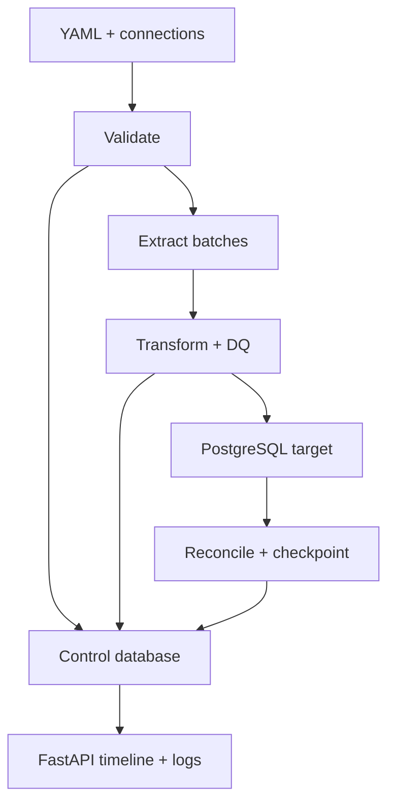

# ETLoom

ETLoom is a Python-first, YAML-driven PostgreSQL ETL platform. A pipeline file is the
contract: it declares the input, transformations, output, SQL data-quality checks,
incremental cursor, retries, checkpoints, quarantine rules, and observability settings.

The FastAPI control plane provides a lightweight browser UI for viewing and editing that
YAML, validating it, starting a run, and following the live step timeline and logs. There is
no Node.js build, JavaScript framework, or Docker requirement.

> Status: v0.2 is a working local-development foundation. PostgreSQL is the first connector,
> and one process executes one pipeline at a time. It is not yet a multi-user production
> orchestrator.

## What is included

- Strict, versioned `etloom/v1` YAML models with unknown-field rejection
- Environment-variable secrets in a gitignored connection file
- Chunked full or incremental PostgreSQL extraction
- Stable upper-bound watermarks, tie-breakers, and late-data lookback
- Allow-listed Python transformations—YAML never executes Python code
- Append, replace, and idempotent merge/upsert writes
- SQL-based scalar, failing-row, and source/target comparison checks
- `warn`, `quarantine`, and `fail` DQ actions
- Durable run history, step timing, events, checkpoints, and rejected rows in PostgreSQL
- Retry with exponential backoff for transient database errors
- FastAPI web UI and JSON/SSE API
- CLI, VS Code launch profiles, tests, linting, and optional Docker demo files

## Runtime flow



The checkpoint advances only after the run and post-load checks succeed. With a merge target,
reprocessing a lookback window is idempotent, which gives the pipeline practical at-least-once
delivery.

## Run locally without Docker

You need Python 3.11 or newer, PostgreSQL, Git, and VS Code.

### 1. Clone and open

```bash
git clone https://github.com/themukuls/ETLoom.git
cd ETLoom
code .
```

### 2. Create the Python environment

Windows PowerShell:

```powershell
py -3.11 -m venv .venv
.venv\Scripts\Activate.ps1
python -m pip install --upgrade pip
python -m pip install -e ".[dev]"
```

macOS or Linux:

```bash
python3 -m venv .venv
source .venv/bin/activate
python -m pip install --upgrade pip
python -m pip install -e ".[dev]"
```

In VS Code, run **Python: Select Interpreter** and choose the interpreter inside `.venv`.

### 3. Prepare local PostgreSQL

The bootstrap creates three local databases and a development-only `etloom` login. Run it as
a PostgreSQL administrator:

```bash
psql -U postgres -f sql/bootstrap.sql
```

If `psql` is not on Windows PATH, invoke `psql.exe` from your PostgreSQL `bin` directory. The
script uses `psql` commands such as `\connect`, so direct `psql` execution is the simplest
option.

| Database | Purpose |
|---|---|
| `etl_source` | Seeded `source.transactions` table |
| `etl_target` | Empty `analytics.clean_transactions` target |
| `etl_control` | Run metadata, events, DQ rejects, and checkpoints |

ETLoom creates its control tables on the first run.

### 4. Create local configuration

Windows PowerShell:

```powershell
Copy-Item .env.example .env
Copy-Item config/connections.example.yaml config/connections.yaml
```

macOS or Linux:

```bash
cp .env.example .env
cp config/connections.example.yaml config/connections.yaml
```

Edit `.env` for your own PostgreSQL host, databases, user, and password. ETLoom loads `.env`
automatically and does not overwrite environment variables already supplied by your terminal
or deployment platform. Both `.env` and `config/connections.yaml` are gitignored.

### 5. Validate and run from the terminal

```bash
etloom validate config/pipelines/clean_transactions.yaml
etloom run config/pipelines/clean_transactions.yaml
```

You can also use `python -m etloom.cli.main ...` if the console command is unavailable.

### 6. Start the web UI

```bash
etloom serve --reload
```

Open [http://127.0.0.1:8000](http://127.0.0.1:8000). Select **Clean Transactions** to inspect
or edit its YAML. **Validate** checks the in-browser text. **Save** atomically updates the file.
**Run pipeline** starts the saved configuration and opens the live timeline and event log.

In VS Code, the Run and Debug panel also includes:

- **ETLoom: Web UI**
- **ETLoom: Run sample pipeline**

## YAML contract

Start from [`config/pipelines/pipeline.template.yaml`](config/pipelines/pipeline.template.yaml).
The runnable example is
[`config/pipelines/clean_transactions.yaml`](config/pipelines/clean_transactions.yaml).

| Section | What it controls |
|---|---|
| `metadata` | Stable ID, name, owner, tags, enabled state |
| `parameters` | Typed future/runtime values and defaults |
| `input` | Connection, table, selected columns, filter, extraction mode and cursor |
| `transformations` | Ordered derive, cast, rename, and deduplicate operations |
| `output` | Target table, write mode, merge keys, staging, transaction, schema policy |
| `data_quality` | Staged SQL checks, expectations, severity, and failure action |
| `quarantine` | Rejected-row destination and retained context |
| `checkpoint` | Durable incremental progress and update policy |
| `runtime` | Timeout, retries, failure policy, and resource bounds |
| `observability` | Log format, captured metrics, and audit retention intent |

SQL DQ checks run at one of six stages: `pre_extract`, `post_extract`, `post_transform`,
`pre_load`, `post_load`, or `reconciliation`. Queries can safely reference these placeholders:

| Placeholder | Value |
|---|---|
| `{{ source }}` | Quoted input table |
| `{{ staging }}` | Quoted current staging table |
| `{{ target }}` | Quoted output table |
| `{{ run_id }}` | Parameterized run UUID |
| `{{ pipeline_id }}` | Parameterized pipeline ID |
| `{{ execution_date }}` | Parameterized run date |
| `{{ previous_watermark }}` | Parameterized saved cursor |
| `{{ current_watermark }}` | Parameterized upper cursor |

Identifiers are generated by ETLoom and quoted; values are bound as SQL parameters. SQL in a
pipeline is still trusted project code and should be reviewed like application SQL.

## API

| Method and path | Purpose |
|---|---|
| `GET /health` | Process health and version |
| `GET /api/pipelines` | List configured pipelines |
| `GET /api/pipelines/{id}` | Return YAML and parsed configuration |
| `POST /api/pipelines/validate` | Validate unsaved YAML |
| `PUT /api/pipelines/{id}` | Validate and atomically save YAML |
| `POST /api/pipelines/{id}/runs` | Queue a pipeline run |
| `GET /api/runs` | Recent run history |
| `GET /api/runs/{run_id}` | Run details and steps |
| `GET /api/runs/{run_id}/events` | Server-sent live events |

## Development checks

```bash
python -m ruff format --check .
python -m ruff check .
python -m pytest
```

The test suite covers YAML validation and atomic writes, transformations, SQL DQ behavior,
and the FastAPI pages/API without requiring a running PostgreSQL instance.

## Current boundaries and roadmap

The v0.2 runner is intentionally straightforward. Before exposing it to untrusted users or
running multiple workers, add authentication/authorization, CSRF protection, a proper job
queue, connection pooling, cancellation, scheduler/locks, secrets management, schema-evolution
execution, and Prometheus/OpenTelemetry exporters. Planned connectors include CSV/object
storage and HTTP APIs.

Optional Docker files remain for contributors who want a disposable demo database; the normal
local workflow above does not use Docker.

## License

Apache License 2.0.
